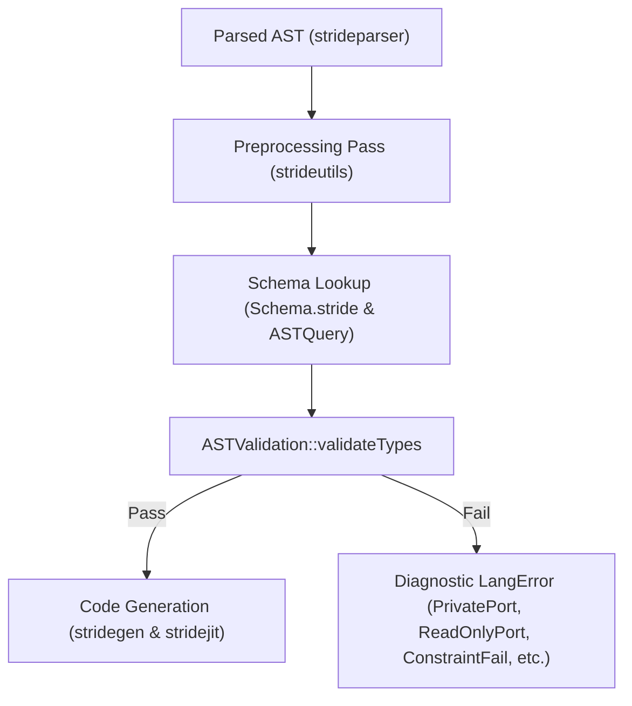

# Schema Validation in Stride

Stride features a compile-time schema validation subsystem that inspects entity declarations, module definitions, property values, and collections against declarative schema specifications.

Schemas are authored in Stride syntax (principally in [`Schema.stride`](file:///C:/Users/Andres/source/repos/Stride/strideroot/library/1.0/Schema.stride)) and evaluated by [`ASTValidation`](file:///c:/Users/Andres/source/repos/boardgame/libgame/external/strideutils/src/astvalidation.cpp) in `strideutils` during AST preprocessing.

---

## 1. Core Architecture

The schema validator enforces syntactic and semantic constraints early in compilation before code generation begins:



- **Type Schemas**: Defined via `type <TypeName> { properties: [ ... ] inherits: [ ... ] final: <on|off> }`.
- **Property Specifications**: Defined via `typeProperty <PropName> { ... }`.
- **Constraint Blocks**: Special inline entities (`constrainedInt`, `constrainedReal`, `constrainedString`, `constrainedList`, `constrainedEntity`) constraining values.

---

## 2. Property Specifications (`typeProperty`)

Every property declared in a type schema controls how callers configure and interact with instances of that type:

| Attribute | Type | Default | Description |
|---|---|---|---|
| `name` | `_StringLiteral` | (required) | Name of the property as written in declarations or calls. |
| `allowedTypes` | `_Any`, `_List`, or constraint | (required) | Permitted types, literals, sub-types, or constraint blocks. |
| `default` | `_Any` | `none` | Default fallback value if omitted in an instance. |
| `required` | `_SwitchLiteral` | `off` | When `on`, omitting the property in a declaration produces an error. |
| `public` | `_SwitchLiteral` | `on` | When `on`, the property may be read externally via member access (`Instance.property`). When `off`, external reads emit `LangError::PrivatePort`. |
| `writeable` | `_SwitchLiteral` | `on` | When `on`, the property may be written in declarations. When `off`, writing to the property emits `LangError::ReadOnlyPort`. |

### Example: Public and Writeable Access Control

```stride
type _SensorSpec {
    typeName: "sensorSpec"
    properties: [
        typeProperty ConfigRate {
            name: "rate"
            allowedTypes: _IntLiteral
            default: 100
            public: on
            writeable: on
        },
        typeProperty ReadOnlyState {
            name: "hardwareVersion"
            allowedTypes: _IntLiteral
            default: 2
            public: on
            writeable: off    # Read-only: cannot be written in declarations
        },
        typeProperty InternalSecret {
            name: "calibrationKey"
            allowedTypes: _IntLiteral
            default: 9999
            public: off       # Private: cannot be read via Sensor.calibrationKey
            writeable: on
        }
    ]
}
```

### Final Types (`final`)

Types can disallow inheritance by specifying `final: on`:

```stride
type _FinalBase {
    typeName: "finalBase"
    final: on
}

type _ForbiddenChild {
    typeName: "forbiddenChild"
    inherits: [_FinalBase]    # Error: InheritedFinalType
}
```

When `final: on` is specified on a type, any declaration referencing it in its `inherits` list is rejected at compile time with `LangError::InheritedFinalType`.

---

## 3. Scalar Constraints

Scalar constraints enforce range limits, step sizes, and string lengths on primitive values.

### `constrainedInt` & `constrainedReal`

Enforce numeric boundaries on integer and floating-point properties:

| Property | Type | Description |
|---|---|---|
| `minimum` | Numeric | Lower bound (inclusive). |
| `maximum` | Numeric | Upper bound (inclusive). |
| `exclusiveMinimum` | Numeric | Lower bound (exclusive: value must be strictly `>`). |
| `exclusiveMaximum` | Numeric | Upper bound (exclusive: value must be strictly `<`). |
| `multipleOf` | Numeric | Value must be an exact positive multiple (`value % step == 0`). Must be `> 0`. |

```stride
typeProperty GainProp {
    name: "gain"
    allowedTypes: [
        constrainedReal {
            minimum: 0.0
            maximum: 1.0
        }
    ]
}
```

### `constrainedString`

Enforces length limits and regex pattern matching on string properties:

| Property | Type | Description |
|---|---|---|
| `minLength` | `Int` | Minimum string character length. |
| `maxLength` | `Int` | Maximum string character length. |
| `pattern` | `String` | Regular expression pattern the string must match. |

---

## 4. Collection Constraints (`constrainedList`)

Collection constraints validate lists, arrays, and generator ranges assigned to properties.

| Property | Type | Default | Description |
|---|---|---|---|
| `minItems` | `Int` | `none` | Minimum total number of items in the collection. |
| `maxItems` | `Int` | `none` | Maximum total number of items in the collection. |
| `uniqueItems` | `Switch` | `off` | When `on`, asserts that all items in the list are structurally unique. |
| `allowed` | `List` | `[]` | List of allowed types or sub-types permitted in the collection. |
| `contains` | Type or `List` | `none` | Sub-type that elements in the collection must match against. |
| `minContains` | `Int` | `1` (if `contains` set) | Minimum number of items that must match the `contains` sub-type. |
| `maxContains` | `Int` | `none` | Maximum number of items that must match the `contains` sub-type. |
| `uniqueBy` | `String` | `none` | Asserts that all entity blocks within the list have unique values for a specified property (e.g. `"name"` or `"index"`). |

---

## 5. Advanced Collection Constraint Capabilities

### 5.1 Sub-Type Matching with `contains`, `minContains`, and `maxContains`

`contains` validates that a heterogeneous list includes required types, while `minContains` and `maxContains` bound the frequency of those types:

```stride
type PipelineConfig {
    typeName: "pipelineConfig"
    properties: [
        typeProperty StageList {
            name: "stages"
            allowedTypes: [
                constrainedList {
                    minItems: 1
                    # Must contain at least 1 and at most 2 output sinks
                    contains: OutputSink
                    minContains: 1
                    maxContains: 2
                }
            ]
        }
    ]
}
```

- If `contains` is specified without `minContains`, `minContains` defaults to `1` (at least one matching element required).
- Setting `minContains: 0` makes the matching sub-type optional while still enforcing `maxContains`.
- If fewer than `minContains` or more than `maxContains` elements match, validation reports `LangError::ConstraintFail`.

### 5.2 Property-Based Uniqueness with `uniqueBy`

`uniqueBy` asserts that all entity declarations or references inside a collection have distinct values for a given property:

```stride
type SystemManifest {
    typeName: "systemManifest"
    properties: [
        typeProperty Devices {
            name: "devices"
            allowedTypes: [
                constrainedList {
                    # Disallows two devices with the same name or hardware index
                    uniqueBy: "name"
                }
            ]
        }
    ]
}
```

- Supports resolving both explicit instance properties and schema default values.
- Checks inline block declarations as well as references to external entity declarations.
- If two items in the collection share the same resolved property value, validation reports `LangError::ConstraintFail`.

---

## 6. Constraint Guards

The validator performs self-consistency checking ("guard validation") on constraint declarations to catch invalid schema definitions at compile time:

- **Numeric Guards**:
  - `multipleOf > 0`
  - `minimum <= maximum`
  - `exclusiveMinimum < maximum` and `minimum < exclusiveMaximum`
- **Collection Guards**:
  - `minItems <= maxItems`
  - `minContains <= maxContains`

---

## 7. Diagnostic Error Types

Schema validation emits strongly typed errors from [`LangError::ErrorType`](file:///c:/Users/Andres/source/repos/boardgame/libgame/external/strideparser/include/stride/parser/langerror.h#L30):

| Error | Emitted When |
|---|---|
| `InvalidPort` | A declaration or call sets a property not declared on the target type schema. |
| `InvalidPortType` | The assigned value does not match any of the schema's `allowedTypes`. |
| `PrivatePort` | A property with `public: off` is accessed via member access (`Obj.prop`). |
| `ReadOnlyPort` | A property with `writeable: off` is assigned in a declaration. |
| `ConstraintFail` | A scalar boundary, regex pattern, collection size, `contains` count, or `uniqueBy` uniqueness check fails. |
